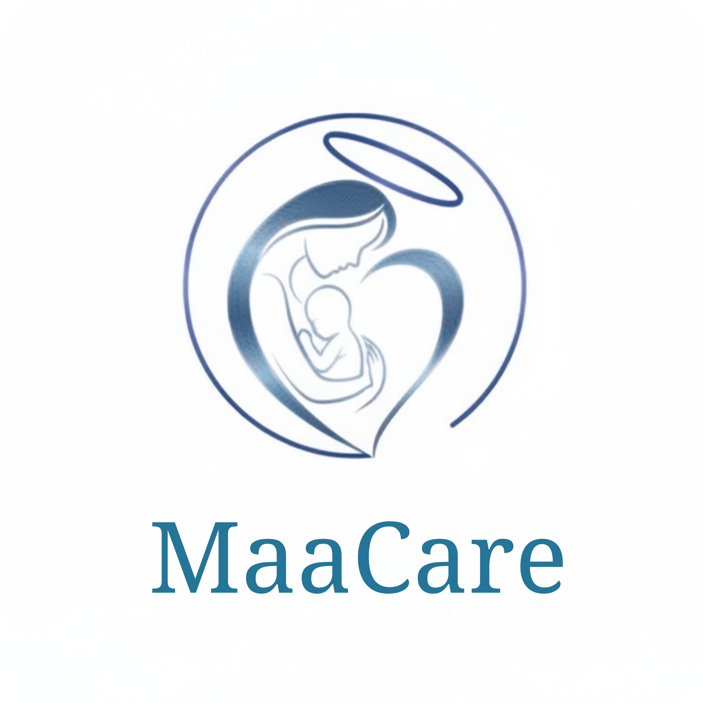
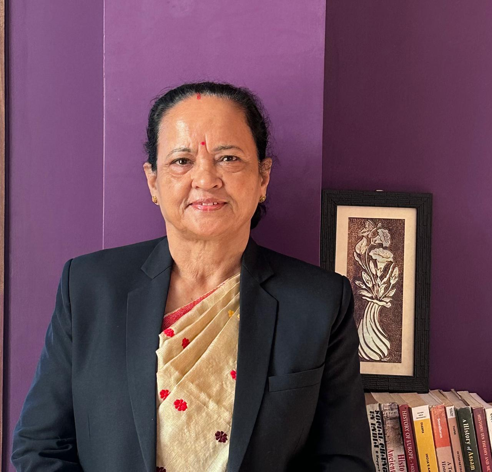

# Maa Park Team Members Documentation

This document contains official records and profiles of the core team members of **Maa Park** and its flagship product, **MaaCare**.

---

## 👥 Core Executive & Clinical Governance Board

| Photo | Name | Designation & Credentials | Key Expertise & Honors |
| :---: | :--- | :--- | :--- |
|  | **Dr. Jayanta Prasad Sarma** | Co-Founder & Advisor of MaaCare App | MBBS · MS · DIS · PGDIS · MBA (Healthcare Mgmt.) · Ex-MD (GNRC, Desun, Marwari) · World Bank Awardee (₹1 Cr, 2014) |
|  | **Prof. (Dr.) Hemeswari Bhuyan** | Founder & Mentor — MaaCare \| Chief Clinical Advisor | Principal, Dispur Nursing Institute (DNI) · Former Principal, RCN Guwahati · Ex-Capt. MNS (TA) · 38+ Years Exp. · PhD Guide |
|  | **Manirul Hussain** | Co-Founder, CEO & Lead Architect — Maa Park | Clinical Innovator & Full-Stack AI Engineer · TNAI & Koita Fast Track Learner Awardee · B.Sc. Nursing (RGU) |
|  | **Julfikar Ali** | Chief Innovation Officer (CIO) & Lead Researcher — Maa Park | Lead Researcher & Clinical Nursing · TNAI & Koita Fast Track Learner Awardee · B.Sc. Nursing (RGU) |

---

## 👤 Executive Profiles

### 1. Dr. Jayanta Prasad Sarma
* **Designation:** Co-Founder & Advisor of MaaCare App
* **Qualifications:** MBBS · MS · DIS · PGDIS · MBA (Healthcare Mgmt.)
* **Experience & Governance:** 31+ Years Healthcare Leadership. Former Medical Director at GNRC Hospitals, Desun Hospitals, and Marwari Hospitals. World Bank Awardee (₹1 Cr, 2014) for healthcare systems innovation. NABH accreditation lead.

---

### 2. Prof. (Dr.) Hemeswari Bhuyan
* **Designation:** Founder & Mentor — MaaCare | Chief Clinical Advisor
* **Current Role:** Principal, Dispur Nursing Institute (DNI), Guwahati
* **Historic Governance:** Former Principal, Regional College of Nursing (RCN), Guwahati; Former Vice Principal & HOD, Royal School of Nursing, RGU; Veteran Captain, Military Nursing Service (TA), Guwahati; Recognized PhD supervisor; 38+ years experience, 27 publications, 1 book, 3 patents.

---

### 3. Manirul Hussain
* **Designation:** Co-Founder, CEO & Lead Architect — Maa Park
* **Credentials:** Clinical Innovator & Full-Stack AI Engineer; Digital Health Foundation Fast Track Learner Awardee (TNAI & Koita Foundation); B.Sc. Nursing (The Assam Royal Global University).
* **Scope:** Full-Stack Architecture, AI & ML Clinical Integration, Cloud Infrastructure, Product Vision.

---

### 4. Julfikar Ali
* **Designation:** Chief Innovation Officer (CIO) & Lead Researcher — Maa Park
* **Credentials:** Lead Researcher & Clinical Nursing; Digital Health Foundation Fast Track Learner Awardee (TNAI & Koita Foundation); B.Sc. Nursing (The Assam Royal Global University).
* **Scope:** Clinical Research Frameworks, Digital Health Innovation, Community Health Outreach.

---

## 📈 Company Commitment Statistics

> [!NOTE]
> Cumulative experience and intellectual assets of our team:
* **38+ Years of Experience:** Combined clinical, teaching, research, and administrative expertise in healthcare.
* **27+ Publications:** National and international research publications in community health and maternal care.
* **3 Patents:** Innovative healthcare solutions and digital innovations in maternal health.
